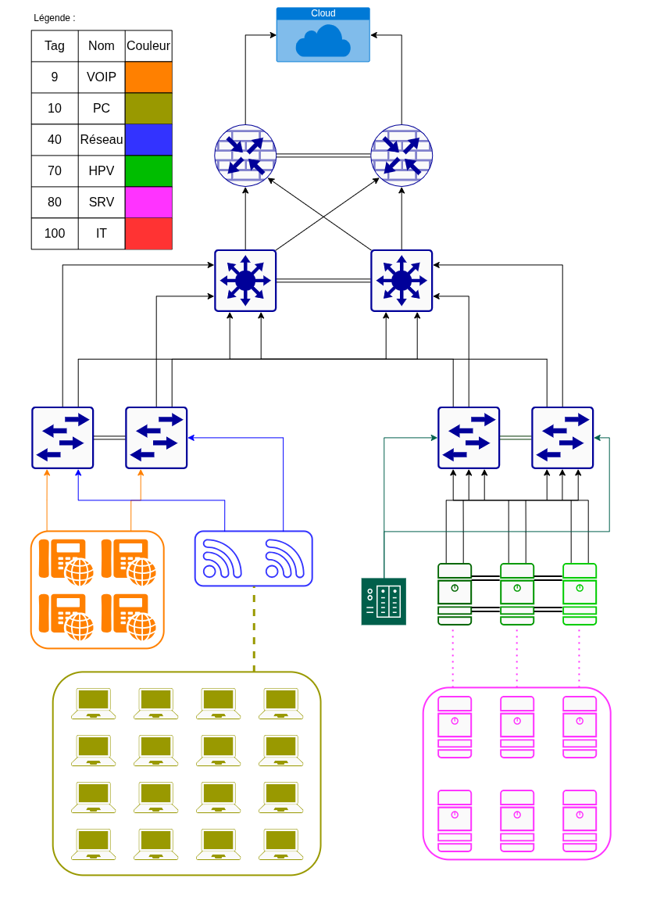

# NovaCorp — Architecture réseau du site AIX

Projet d'architecture réseau (Master 2) : conception et maquettage sous **Cisco Packet Tracer** du réseau LAN du site d'Aix (AIX) de l'entreprise fictive **NovaCorp**.

Le réseau est entièrement redondé : deux pare-feux en sortie Internet, deux cœurs de réseau L3, et des switchs d'accès raccordés aux deux cœurs.



---

## Contenu du dépôt

| Fichier | Description |
|---|---|
| [`NovaCorp.drawio.png`](NovaCorp.drawio.png) | Schéma d'architecture du site AIX (topologie et légende des VLANs) |
| [`IPV4-IPV6_Nommage_Inventaire.xlsx`](IPV4-IPV6_Nommage_Inventaire.xlsx) | Plan d'adressage IPv4/IPv6, inventaire des IP fixes et convention de nommage |
| [`novacorp.pkt`](novacorp.pkt) | Maquette Cisco Packet Tracer configurée |
| [`CHANGELOG.md`](CHANGELOG.md) | Historique détaillé des étapes, problèmes rencontrés et validations |

---

## Topologie

```
                          Internet (Cloud)
                         /               \
                 FW-AIX-01  ── HSRP ──  FW-AIX-02        (routeurs PT8200)
                         \               /
                 SW-AIX-05 ══ Po1 LACP ══ SW-AIX-06      (cœurs L3, Cisco 3560)
                  /    |    |       |    |     \
          SW-AIX-01  SW-AIX-02    SW-AIX-03  SW-AIX-04   (accès, Cisco 2960)
          Téléphones, bornes Wi-Fi   Hyperviseurs, NAS
          → laptops (Wi-Fi)          → VMs serveurs
```

- Chaque switch d'accès est raccordé aux **deux** cœurs (double attachement).
- Les deux cœurs sont reliés par un **EtherChannel LACP** (Fa0/7-8 → Port-channel1).
- Chaque pare-feu est câblé aux deux cœurs ; les liens croisés (Gi0/0/1) sont en `shutdown`, la redondance étant assurée par HSRP.

### Équipements de la maquette

| Rôle | Équipements | Modèle Packet Tracer |
|---|---|---|
| Pare-feux | FW-AIX-01, FW-AIX-02 | PT8200 |
| Cœurs L3 | SW-AIX-05, SW-AIX-06 | Cisco 3560-24PS |
| Accès utilisateurs | SW-AIX-01, SW-AIX-02 | Cisco 2960-24TT |
| Accès serveurs | SW-AIX-03, SW-AIX-04 | Cisco 2960-24TT |
| Hyperviseurs | HPV-AIX-01 à 03 | Server-PT |
| Téléphones IP | TEL-AIX-01 à 04 | Home-VoIP-PT |
| Bornes Wi-Fi | AP-AIX-01 à 04 | AccessPoint-PT |
| Postes clients | PC-AIX-01 à 04 | Laptop-PT |

---

## Plan d'adressage

| VLAN | Nom | Usage | Réseau IPv4 | Passerelle (VIP HSRP) | Préfixe IPv6 |
|---|---|---|---|---|---|
| 9 | VOIP | Téléphones IP | 192.168.9.0/24 | 192.168.9.254 | fd3a:91c4:5e07:9::/64 |
| 10 | PC | Postes utilisateurs | 192.168.10.0/24 | 192.168.10.254 | fd3a:91c4:5e07:10::/64 |
| 40 | RESEAUX | Switchs, pare-feux, bornes Wi-Fi | 192.168.40.0/27 | 192.168.40.30 | fd3a:91c4:5e07:40::/64 |
| 70 | HPV | Hyperviseurs | 192.168.70.0/29 | 192.168.70.6 | fd3a:91c4:5e07:70::/64 |
| 80 | SRV | Serveurs, NAS | 192.168.80.0/24 | 192.168.80.254 | fd3a:91c4:5e07:80::/64 |
| 100 | IT | Administration | 192.168.100.0/26 | 192.168.100.62 | fd3a:91c4:5e07:100::/64 |

> Le plan IPv6 (préfixes ULA `fd3a:91c4:5e07::/48`) est défini dans le tableur mais n'est pas encore configuré dans la maquette.

### Adresses fixes principales

| Équipement | Adresse |
|---|---|
| FW-AIX-01 / FW-AIX-02 | 192.168.40.1 / .2 — VIP HSRP **192.168.40.20** |
| SW-AIX-01 à 04 (management) | 192.168.40.3 à .6 |
| SW-AIX-05 / 06 | 192.168.40.7 / .8 |
| AP-AIX-01 à 10 | 192.168.40.9 à .18 |
| HPV-AIX-01 à 03 | 192.168.70.1 à .3 |
| NAS-AIX-01 | 192.168.80.1 |
| TEL-AIX-01 à 65 | 192.168.9.1 à .65 (réservées ; en DHCP dans la maquette) |

L'inventaire complet est dans l'onglet **Inventaire** du tableur.

### Convention de nommage

Format **`SSS-VVV-00`** : type d'équipement – trigramme de ville – incrément (01 à 99).

- **Types :** `SRV` (serveur), `DC` (contrôleur de domaine), `PC`, `SW` (switch), `FW` (pare-feu), `AP` (borne Wi-Fi), `TEL` (téléphone IP), `HPV` (hyperviseur), `NAS`.
- **Villes :** `AIX`, `PEY`, `MRS`.
- **Exemples :** `SW-AIX-01`, `PC-PEY-01`, `FW-AIX-02`.

---

## Protocoles en place

| Protocole | Couche | Où | Rôle |
|---|---|---|---|
| 802.1Q | 2 | Trunks entre les 6 switchs | Transporter les VLANs 9, 10, 40, 70, 80, 100 |
| VTP transparent | 2 | Les 6 switchs | VLANs gérés localement sur chaque switch |
| Rapid PVST+ (802.1w) | 2 | Les 6 switchs | Anti-boucle, root réparti entre les deux cœurs |
| PortFast + BPDU Guard | 2 | Ports d'accès (TEL, AP, HPV, FW) | Activation immédiate, coupure si un switch est branché |
| Root Guard | 2 | Cœurs, ports vers l'accès | Empêcher un switch d'accès de devenir root |
| LACP (802.3ad) | 2 | SW-05 ↔ SW-06 (Po1) | Agréger les deux liens inter-cœurs |
| Routage inter-VLAN (SVI) | 3 | SW-05 et SW-06 | Communication entre VLANs |
| HSRP | 3 | Cœurs et pare-feux | Passerelle redondante |
| Routage statique | 3 | Cœurs et pare-feux | Route par défaut vers les FW, retour vers les réseaux internes |
| DHCP | 7 | SW-05 et SW-06 | Adressage automatique des téléphones et laptops |

### Répartition des rôles entre les cœurs

Le root STP et le routeur HSRP actif sont alignés par VLAN, pour équilibrer la charge :

| VLANs | Root STP / HSRP actif | Backup |
|---|---|---|
| 9, 10, 100 | SW-AIX-05 | SW-AIX-06 |
| 40, 70, 80 | SW-AIX-06 | SW-AIX-05 |

- STP : priorité 24576 (primaire) / 28672 (secondaire).
- HSRP : priorité 110 + `preempt` sur l'actif, 100 + `preempt` sur le backup.
- Côté pare-feux : FW-AIX-01 actif (HSRP groupe 41, priorité 110), FW-AIX-02 en standby.

### DHCP

Les pools `VOIP` et `PC` sont découpés entre les deux cœurs pour éviter les doublons tout en restant redondants :

| Cœur | VLAN 9 | VLAN 10 |
|---|---|---|
| SW-AIX-05 | 192.168.9.1 – .127 | 192.168.10.1 – .127 |
| SW-AIX-06 | 192.168.9.128 – .250 | 192.168.10.128 – .250 |

Les adresses `.251` à `.254` sont exclues (IP des cœurs et VIP HSRP).

---

## Utilisation

1. Ouvrir `novacorp.pkt` avec **Cisco Packet Tracer**.
2. Commandes utiles pour vérifier l'état du réseau :

```
show vlan brief
show interfaces trunk
show spanning-tree
show etherchannel summary
show standby brief
show ip route
show ip dhcp binding
```

3. Tests de bout en bout : depuis un laptop (VLAN 10), ping de la passerelle `192.168.10.254`, d'un téléphone (VLAN 9) et de la VIP des pare-feux `192.168.40.20`.

---

## Avancement

| Version | Étape | Statut |
|---|---|---|
| 0.1 | Schéma d'architecture | ✅ |
| 0.2 | Adressage IP, inventaire, nommage | ✅ |
| 0.3 | Infrastructure de base dans Packet Tracer | ✅ |
| 0.4 | VLANs et trunks 802.1Q | ✅ |
| 0.5 | Rapid PVST+ et LACP | ✅ |
| 0.6 | Ports d'accès et protections STP | ✅ |
| 0.7 | Routage, HSRP, pare-feux | ✅ |
| 0.8 | DHCP | ✅ |
| 0.9 | Récapitulatif des protocoles | ✅ |

Le détail de chaque étape (commandes, problèmes rencontrés et corrections) est dans le [CHANGELOG](CHANGELOG.md).

### Pistes à venir

- Configuration IPv6 (adressage, SLAAC/DHCPv6, HSRPv2).
- Raccordement du NAS et des serveurs (VLAN 80) dans la maquette.
- Filtrage (ACL) sur les pare-feux et NAT vers Internet.
- Interconnexion avec les autres sites (PEY, MRS).
